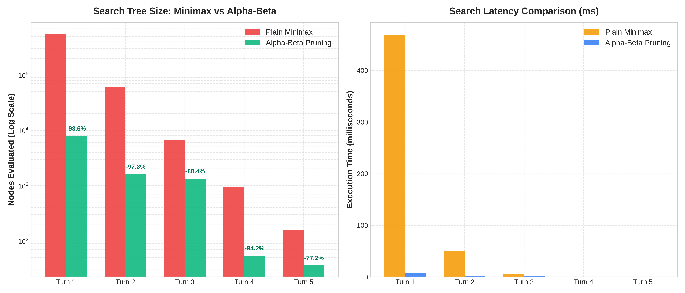

# Tic Tac Toe AI Agent (Minimax + Alpha-Beta Pruning)

> **Artificial Intelligence and Soft Computing (AISC) Project**  
> *Author:* Hardik Tomar  
> *Language:* Python 3.12+ (Material Design 3 GUI with Flet)  
> *Core Algorithms:* Adversarial Search (Plain Minimax & Alpha-Beta Pruning implemented from scratch)

---

## 📌 Project Overview

This project is an unbeatable desktop Tic Tac Toe game powered by an autonomous, utility-based AI agent that uses **Adversarial Search (Minimax with Alpha-Beta Pruning)** written in pure Python without third-party AI or machine-learning libraries. 

Against perfect human play, the game is mathematically guaranteed to conclude in a draw; any human mistake is exploited by the agent to secure a win. The application features a **Material Design 3** interface that reports live search metrics (nodes evaluated and execution time in milliseconds) to demonstrate the efficiency gains of alpha-beta pruning over unpruned minimax.



---

## 🎓 AISC Syllabus Alignment & Agent Formulation

### 1. PEAS Description (Intelligent Agent Design)
| Element | Definition in this System |
| :--- | :--- |
| **Performance Measure** | Never loses; wins whenever human errs; prefers quickest win ($10 - d$) and delays unavoidable loss ($d - 10$); draws against optimal play. |
| **Environment** | 3×3 grid, turn-taking, two players (adversarial zero-sum), discrete, deterministic, fully observable, static. |
| **Actuators** | Places player mark (`'X'` or `'O'`) on any unoccupied grid cell. |
| **Sensors** | Reads the 9-element board state tuple and tracks current turn. |

### 2. State-Space Formulation
- **State Space**: An immutable 9-element tuple where each cell is `' '` (empty), `'X'`, or `'O'`.
- **Initial State**: All 9 cells empty `(' ', ..., ' ')`.
- **Actions**: Place current player's mark in any index $i \in \{0, \dots, 8\}$ where `board[i] == ' '`.
- **Transition Model**: `Result(s, a)` returns a new immutable 9-tuple with mark at $i$.
- **Terminal Test**: Three identical marks aligned horizontally, vertically, or diagonally, or a full board (9 marks placed).
- **Complexity**:
  - Reachable legal board states: **5,478**
  - Possible legal games: **255,168**
  - Full game tree search nodes: **549,946**

### 3. Utility Function (Terminal Evaluation)
$$U(s, d) = \begin{cases} +10 - d & \text{if Agent wins at depth } d \\ d - 10 & \text{if Human wins at depth } d \\ 0 & \text{if Draw (terminal state)} \end{cases}$$

*Rationale:* Subtracting depth $d$ incentivizes the agent to prioritize immediate victories over prolonged winning lines, while maximizing delay on potential losses.

### 4. Heuristic Evaluation (Medium Difficulty, Depth-Limited)
For depth-limited search ($d = 2$), non-terminal states are scored using open winning lines:
$$H(s) = \text{OpenLines}(\text{Agent}) - \text{OpenLines}(\text{Human})$$
Where a winning line (out of 8 possible) is *open* to a player if none of its 3 cells contain the opponent's mark.

### 5. Alpha-Beta Pruning & Move Ordering
Alpha-beta maintains:
- $\alpha$: Highest score guaranteed to the maximizer along current path.
- $\beta$: Lowest score guaranteed to the minimizer along current path.
- **Cutoff Condition:** Prune branch when $\beta \le \alpha$.

To maximize early cutoffs, moves are sorted according to strategic branch-elimination priority:
$$\text{Move Order Priority: } \text{Center (4)} \longrightarrow \text{Corners (0, 2, 6, 8)} \longrightarrow \text{Edges (1, 3, 5, 7)}$$

---

## 📊 Empirical Benchmarks: Minimax vs. Alpha-Beta Pruning

The following benchmark demonstrates the empirical search node counts and execution latencies across game turns:

| Game Turn | Board State Description | Plain Minimax Nodes | Alpha-Beta Nodes | Pruning Reduction | Minimax Time | Alpha-Beta Time |
| :---: | :--- | :---: | :---: | :---: | :---: | :---: |
| **Turn 1** | Empty Board (9 legal moves) | **549,946** | **7,865** | **98.57%** | 469.4 ms | **7.97 ms** |
| **Turn 2** | Human took corner (8 legal) | **59,705** | **1,607** | **97.31%** | 51.0 ms | **1.63 ms** |
| **Turn 3** | Mid-game (7 legal moves) | **6,812** | **1,335** | **80.40%** | 5.71 ms | **1.33 ms** |
| **Turn 4** | Mid-game (6 legal moves) | **935** | **54** | **94.22%** | 0.76 ms | **0.06 ms** |
| **Turn 5** | Late-game (5 legal moves) | **158** | **36** | **77.22%** | 0.14 ms | **0.04 ms** |

> **Key Finding:** On the first turn, Alpha-Beta pruning with strategic move ordering eliminates **542,081 unnecessary node evaluations** (a **98.57% reduction**), dropping latency from nearly 0.5s to under 8ms while maintaining 100% optimal move quality.

---

## 🎯 Functional Requirements Compliance Matrix

| ID | Requirement | Priority | Status | Verification Method |
| :---: | :--- | :---: | :---: | :--- |
| **FR-01** | Choose to play X (first) or O (second) | Must | ✅ PASS | SegmentedButton control updates starter and turn coordination. |
| **FR-02** | 3×3 board; clicking empty cell places mark | Must | ✅ PASS | Interactive M3 grid containers with ripple ink effects. |
| **FR-03** | Ignore occupied cell clicks and game over clicks | Must | ✅ PASS | Validated in controller and unit test suite. |
| **FR-04** | Agent replies automatically after human move | Must | ✅ PASS | Event listener dispatches AI search and board update. |
| **FR-05** | Detects win/loss/draw, announces and highlights winning line | Must | ✅ PASS | Glowing green winning line highlight + M3 Dialog announcement. |
| **FR-06** | Agent can choose moves with plain minimax | Must | ✅ PASS | Implemented in `ai/minimax.py` with baseline node counter. |
| **FR-07** | Minimax + alpha-beta pruning returning identical values | Must | ✅ PASS | Verified via parameterized equivalence tests across game states. |
| **FR-08** | Difficulty levels: Random Moves and Minimax (Unbeatable) | Should | ✅ PASS | Dropdown selector linked to `ai/agent.py`. |
| **FR-09** | Switch alpha-beta pruning on/off | Should | ✅ PASS | Switch control toggles pruning and compares live node counters. |
| **FR-10** | Live telemetry: nodes evaluated and time taken in ms | Should | ✅ PASS | Dedicated M3 stats telemetry card updated on every move. |
| **FR-11** | Restart button and session scoreboard | Should | ✅ PASS | Reset button + chips tracking Player Wins, Agent Wins, Draws. |
| **FR-12** | Hint button suggests best move for human | Could | ✅ PASS | Optimal move calculation highlights recommended cell in gold. |
| **FR-13** | Show minimax value of every empty cell | Could | ✅ PASS | Toggle renders real-time utility badges on all legal cells. |
| **FR-14** | Light and dark theme toggle | Could | ✅ PASS | AppBar theme switcher toggles M3 color palette dynamically. |

---

## 🏗️ Technical Architecture & Project Structure

The project strictly decouples game rules, AI search, and UI rendering:

```
tictactoe-ai/
├── main.py                     # Entry point launching the desktop interface
├── requirements.txt            # Python dependencies (flet, pytest, matplotlib)
├── pytest.ini                  # Pytest configuration
├── game/
│   ├── __init__.py
│   ├── board.py                # Pure immutable board state, rules, terminal checks
│   └── controller.py           # Decoupled gameplay coordinator and scoreboard
├── ai/
│   ├── __init__.py
│   ├── minimax.py              # Pure Minimax with node visitation counter
│   ├── alphabeta.py            # Alpha-Beta pruning with move ordering & heuristic
│   └── agent.py                # Difficulty strategies, hint generator, timing
├── ui/
│   ├── __init__.py
│   └── app.py                  # Material Design 3 interactive UI with Flet
├── tests/
│   ├── test_board.py           # Rules engine tests (all 8 winning lines, draws)
│   └── test_agent.py           # Equivalence, zero-loss guarantee, speed tests
├── scripts/
│   └── generate_report_charts.py # Automated benchmark and chart generator
└── docs/
    └── pruning_comparison.png  # Generated research figure for project report
```

---

## 🚀 Setup & Execution Guide

### Prerequisites
- Python 3.10, 3.11, or 3.12

### 1. Setup Virtual Environment & Install Dependencies
```bash
python3 -m venv .venv
source .venv/bin/activate
pip install -r requirements.txt
```

### 2. Run the Game
```bash
python3 main.py
```

### 3. Run Automated Test Suite
```bash
pytest -v -s
```
*(All 29 tests verify rules engine lines, value equivalence, and unbeatable agent guarantees).*

### 4. Re-run Experimental Benchmarks
```bash
python3 scripts/generate_report_charts.py
```

---

## 🗣️ AISC Viva Voce Questions & Answers

**Q1: Why does Tic Tac Toe with two optimal players always end in a draw?**  
> *Ans:* Tic Tac Toe is a finite, deterministic, two-player zero-sum game of perfect information. By the minimax theorem (Zermelo's theorem), every position has a unique game-theoretic value under optimal play. For the empty board, that value is $0$ (draw).

**Q2: What is the purpose of subtracting depth ($10 - \text{depth}$) in the utility function?**  
> *Ans:* Without depth factoring, an agent is indifferent between winning on the very next turn versus 5 turns later (both would score $+10$). Subtracting depth gives preference to immediate wins (e.g. depth 1 scores $9$, depth 3 scores $7$) and forces the agent to delay defeat as long as possible if faced with an inevitable loss.

**Q3: How does move ordering affect alpha-beta pruning?**  
> *Ans:* Alpha-beta pruning performance depends heavily on the order in which child nodes are evaluated. If the best moves are examined first, $\alpha$ rises and $\beta$ drops rapidly, causing early cutoffs ($\beta \le \alpha$). Evaluating the center cell first, followed by corners, and finally edges reduces the search tree from $549,946$ nodes to only $7,865$ nodes ($98.6\%$ cutoff efficiency).

**Q4: How does the Medium difficulty level work?**  
> *Ans:* Medium uses depth-limited alpha-beta search capped at depth $2$. Instead of expanding down to terminal states, it estimates board utility using an open-lines heuristic: $\text{OpenLines}(\text{Agent}) - \text{OpenLines}(\text{Human})$, where an open line is any row, column, or diagonal that does not contain an opponent's mark.
